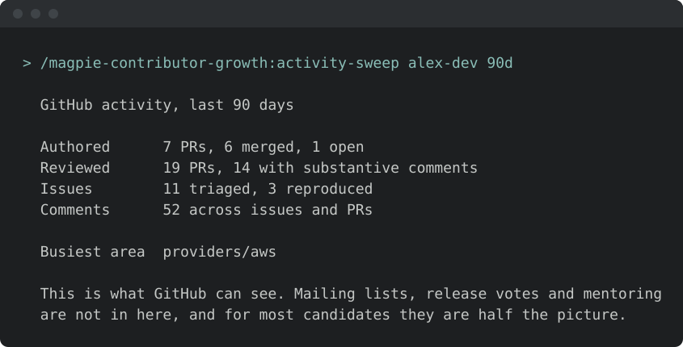
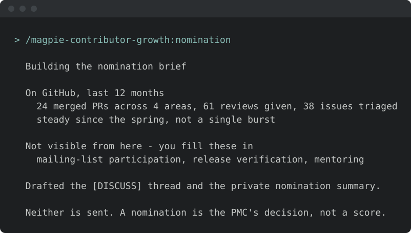
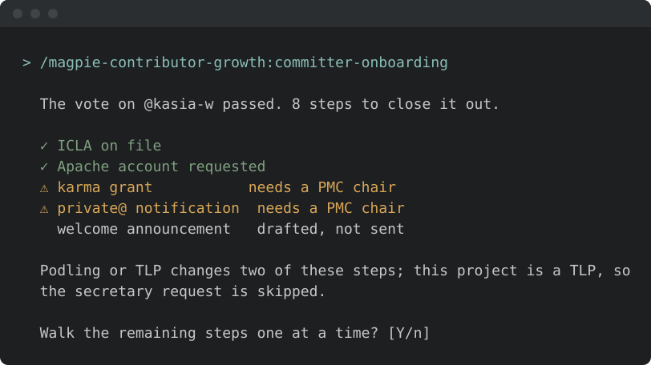

<!-- START doctoc generated TOC please keep comment here to allow auto update -->
<!-- DON'T EDIT THIS SECTION, INSTEAD RE-RUN doctoc TO UPDATE -->
**Table of Contents**  *generated with [DocToc](https://github.com/thlorenz/doctoc)*

- [Install & first runs](#install--first-runs)
  - [Before the first run](#before-the-first-run)
  - [Try these first](#try-these-first)

<!-- END doctoc generated TOC please keep comment here to allow auto update -->

<!-- SPDX-License-Identifier: Apache-2.0
     https://www.apache.org/licenses/LICENSE-2.0 -->

# Install & first runs

Install just this family — one plugin, 9 skills. The path-to-committer track.

Once you have [added the marketplace](../setup/marketplace-install.md):

```text
/plugin install magpie-contributor-growth@apache-magpie
```

New to Magpie? The [quick start](../quick-start.md) walks the whole path in
one place — install, the first `/magpie-setup:setup` run, and a recording of it
happening — plus the other agents and the secure-isolation setup to run next.

The first contributor-growth skill you run opens with a one-minute
[welcome guide](../../plugins/magpie-setup/skills/setup/setup_preflight/guides/contributor-growth.md):
the typical flow, what needs configuring, what to ask it, and how to make it yours.
Dismiss it, or hide it for good, from its last line;
*"show the contributor-growth welcome again"* or `/magpie-setup:welcome-guide contributor-growth` brings it back.

## Before the first run

<!-- BEGIN generated: skill-config (tools/dev/check-skill-config.py --fix) -->


*Illustrative — the real run derives more and asks better. What is true is
the shape: it runs itself, it writes only your personal layer, and it
stages nothing.*

Every skill here resolves project-specific values from the adopter's
[`<project-config>/`](../../plugins/magpie-setup/templates/) directory — which is
your personal layer first — `.apache-magpie-local/` (gitignored) in a
project that adopted Magpie, `<git-common-dir>/apache-magpie/` in one
that did not — then `.apache-magpie-overrides/` (committed, the project's).

**For yourself:** `/magpie-setup:setup config` scaffolds and fills these locally
(`/magpie-setup config` on a [pinned-snapshot install](../setup/marketplace.md#skill-names-differ-by-install-method)).
Nothing is staged, nothing is committed, and it works on a repository that
has never adopted Magpie.

**This configuration stays personal.** `/magpie-setup:setup adopt` never
promotes or scaffolds it into `.apache-magpie-overrides/`: committed
thresholds would tell every contributor how to game them.

**Required.** Without these a skill would act on a guess, so it stops and
says which file is missing.

| File | What it carries | Read by |
|---|---|---|
| [`committer-onboarding-config.md`](../../plugins/magpie-setup/templates/committer-onboarding-config.md) | Capability-flag vocabulary for committer intake and governance models (`icla`/`dco`/`no-cla`; `asf-pmc`/`github-codeowners`/`maintainer-roster`). | `committer-onboarding` |
| [`committer-readiness.md`](../../plugins/magpie-setup/templates/committer-readiness.md) | The project's declared committer and PMC thresholds — what a contributor's activity is measured against. | `calibrate`, `candidate-screen`, `contributor-to-committer` |
| [`contributor-nomination-config.md`](../../plugins/magpie-setup/templates/contributor-nomination-config.md) | Nomination-brief thresholds and assessment window. | `calibrate`, `candidate-screen`, `nomination` |
| [`contributor-sentiment-config.md`](../../plugins/magpie-setup/templates/contributor-sentiment-config.md) | Signal thresholds for the sentiment gate. Every key has a default. | `sentiment` |
| [`onboarding-concierge-config.md`](../../plugins/magpie-setup/templates/onboarding-concierge-config.md) | The path a new contributor is walked through, and who owns each step. | `onboarding-concierge` |
| [`privacy-llm.md`](../../plugins/magpie-setup/templates/privacy-llm.md) | Which model tier may see which class of content, for projects routing foundation-private information away from third-party models. | `calibrate` |
| [`project.md`](../../plugins/magpie-setup/templates/project.md) | Project manifest. Identity, repositories, mailing lists, tools enabled, CVE tooling, GitHub project-board + issue-template field declarations. The single file every skill reads to resolve project-scoped references. | `activity-sweep`, `calibrate`, `candidate-screen`, `committer-onboarding`, `contributor-to-committer`, `identity-map`, `nomination`, `onboarding-concierge`, `sentiment` |

**Optional.** Each has a documented fallback; absent, the skill still runs.

| File | What it carries | Read by |
|---|---|---|
| [`contributor-identities.md`](../../plugins/magpie-setup/templates/contributor-identities.md) | The project's community channels, and confirmed mappings from each contributor's GitHub handle to their Slack, Discord, mailing-list, and social-media handles. Written by `contributor-identity-map` after a maintainer confirms each one. | `committer-onboarding`, `identity-map`, `nomination` |
| [`issue-tracker-config.md`](../../plugins/magpie-setup/templates/issue-tracker-config.md) | Tracker URL, project key, auth model, default query templates. | `activity-sweep`, `calibrate`, `contributor-to-committer`, `nomination`, `sentiment` |
| [`pmc-roster.md`](../../plugins/magpie-setup/templates/pmc-roster.md) | Who is binding. Read wherever a vote is counted or a PMC-only action is gated. | `candidate-screen`, `nomination` |

<!-- END generated: skill-config -->

## Try these first

*Illustrative shapes, not real transcripts — your output will differ. Nothing
below sends, merges, or posts anything without you confirming it.*

**Sweep recent contributor activity.**

```text
/magpie-contributor-growth:activity-sweep
```



**Draft a nomination brief.**

```text
/magpie-contributor-growth:nomination
```



**Onboard a new committer.**

```text
/magpie-contributor-growth:committer-onboarding
```


