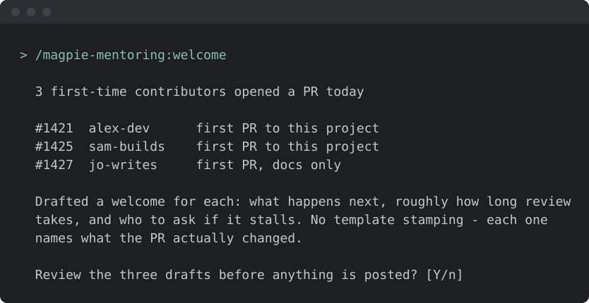
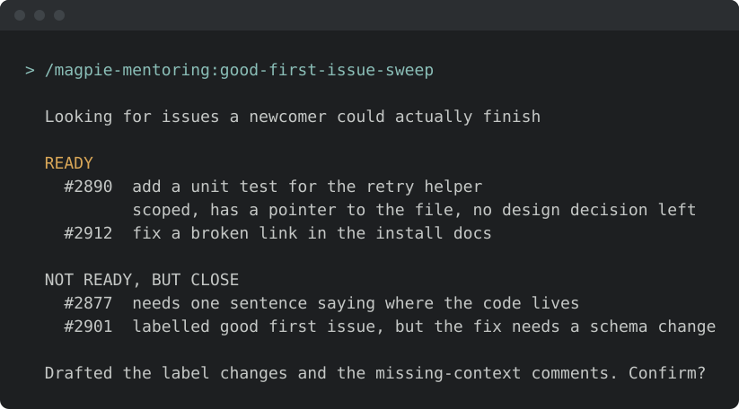
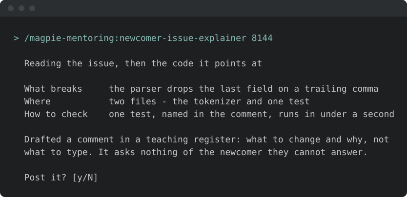

<!-- START doctoc generated TOC please keep comment here to allow auto update -->
<!-- DON'T EDIT THIS SECTION, INSTEAD RE-RUN doctoc TO UPDATE -->
**Table of Contents**  *generated with [DocToc](https://github.com/thlorenz/doctoc)*

- [Install & first runs](#install--first-runs)
  - [Before the first run](#before-the-first-run)
  - [Try these first](#try-these-first)

<!-- END doctoc generated TOC please keep comment here to allow auto update -->

<!-- SPDX-License-Identifier: Apache-2.0
     https://www.apache.org/licenses/LICENSE-2.0 -->

# Install & first runs

Install just this family — one plugin, 4 skills. Newcomer-facing mentoring — welcome, explain, and curate first issues.

Once you have [added the marketplace](../setup/marketplace-install.md):

```text
/plugin install magpie-mentoring@apache-magpie
```

New to Magpie? The [quick start](../quick-start.md) walks the whole path in
one place — install, the first `/magpie-setup:setup` run, and a recording of it
happening — plus the other agents and the secure-isolation setup to run next.

The first mentoring skill you run opens with a one-minute
[welcome guide](../../plugins/magpie-setup/skills/setup/setup_preflight/guides/mentoring.md):
the typical flow, what needs configuring, what to ask it, and how to make it yours.
Dismiss it, or hide it for good, from its last line;
*"show the mentoring welcome again"* or `/magpie-setup:welcome-guide mentoring` brings it back.

## Before the first run

<!-- BEGIN generated: skill-config (tools/dev/check-skill-config.py --fix) -->


*Illustrative — the real run derives more and asks better. What is true is
the shape: it runs itself, it writes only your personal layer, and it
stages nothing.*

Every skill here resolves project-specific values from the adopter's
[`<project-config>/`](../../plugins/magpie-setup/templates/) directory — which is
your personal layer first — `.apache-magpie-local/` (gitignored) in a
project that adopted Magpie, `<git-common-dir>/apache-magpie/` in one
that did not — then `.apache-magpie-overrides/` (committed, the project's).

**For yourself:** `/magpie-setup:setup config` scaffolds and fills these locally
(`/magpie-setup config` on a [pinned-snapshot install](../setup/marketplace.md#skill-names-differ-by-install-method)).
Nothing is staged, nothing is committed, and it works on a repository that
has never adopted Magpie.

**For the project:** [`/magpie-setup:setup adopt`](../setup/team-adoption.md)
commits them for every contributor, either scaffolded directly or promoted
from what you configured locally.

**Required.** Without these a skill would act on a guess, so it stops and
says which file is missing.

| File | What it carries | Read by |
|---|---|---|
| [`good-first-issue-config.md`](../../plugins/magpie-setup/templates/good-first-issue-config.md) | What counts as a good first issue here: labels, size limits, and the areas safe to hand to a newcomer. | `good-first-issue-author`, `good-first-issue-sweep` |
| [`issue-tracker-config.md`](../../plugins/magpie-setup/templates/issue-tracker-config.md) | Tracker URL, project key, auth model, default query templates. | `good-first-issue-author`, `good-first-issue-sweep` |
| [`project.md`](../../plugins/magpie-setup/templates/project.md) | Project manifest. Identity, repositories, mailing lists, tools enabled, CVE tooling, GitHub project-board + issue-template field declarations. The single file every skill reads to resolve project-scoped references. | `good-first-issue-author`, `good-first-issue-sweep`, `newcomer-issue-explainer`, `welcome` |

**Optional.** Each has a documented fallback; absent, the skill still runs.

| File | What it carries | Read by |
|---|---|---|
| [`mentoring-welcome-config.md`](../../plugins/magpie-setup/templates/mentoring-welcome-config.md) | Wording and triggers for first-time-contributor welcomes. | `welcome` |
| [`newcomer-issue-explainer-config.md`](../../plugins/magpie-setup/templates/newcomer-issue-explainer-config.md) | How much context an explanation carries, and the register it is written in. | `newcomer-issue-explainer` |

<!-- END generated: skill-config -->

## Try these first

*Illustrative shapes, not real transcripts — your output will differ. Nothing
below sends, merges, or posts anything without you confirming it.*

**Welcome a first-time contributor.**

```text
/magpie-mentoring:welcome
```



**Curate the good-first-issue backlog.**

```text
/magpie-mentoring:good-first-issue-sweep
```



**Explain an issue to a newcomer.**

```text
/magpie-mentoring:newcomer-issue-explainer
```


