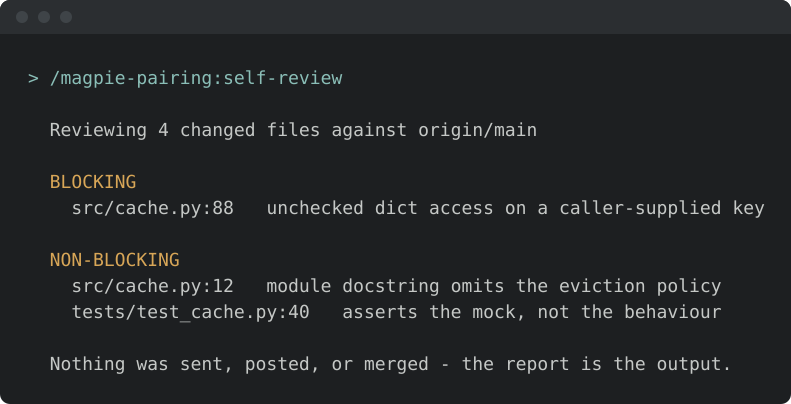
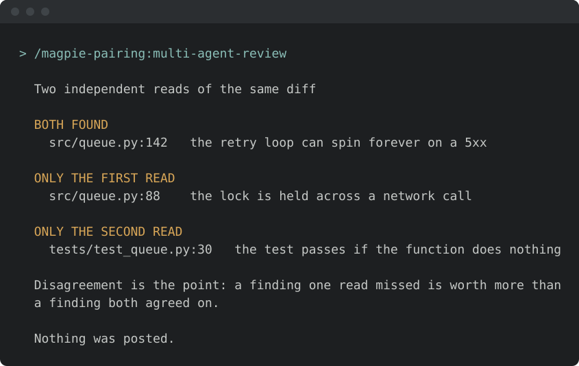

<!-- START doctoc generated TOC please keep comment here to allow auto update -->
<!-- DON'T EDIT THIS SECTION, INSTEAD RE-RUN doctoc TO UPDATE -->
**Table of Contents**  *generated with [DocToc](https://github.com/thlorenz/doctoc)*

- [Install & first runs](#install--first-runs)
  - [Before the first run](#before-the-first-run)
  - [Works well with](#works-well-with)
  - [Try these first](#try-these-first)

<!-- END doctoc generated TOC please keep comment here to allow auto update -->

<!-- SPDX-License-Identifier: Apache-2.0
     https://www.apache.org/licenses/LICENSE-2.0 -->

# Install & first runs

Install just this family — one plugin, 2 skills. Review your own change before anyone else has to.

Once you have [added the marketplace](../setup/marketplace-install.md):

```text
/plugin install magpie-pairing@apache-magpie
```

New to Magpie? The [quick start](../quick-start.md) walks the whole path in
one place — install, the first `/magpie-setup:setup` run, and a recording of it
happening — plus the other agents and the secure-isolation setup to run next.

The first pairing skill you run opens with a one-minute
[welcome guide](../../plugins/magpie-setup/skills/setup/setup_preflight/guides/pairing.md):
the typical flow, what needs configuring, what to ask it, and how to make it yours.
Dismiss it, or hide it for good, from its last line;
*"show the pairing welcome again"* or `/magpie-setup:welcome-guide pairing` brings it back.

## Before the first run

<!-- BEGIN generated: skill-config (tools/dev/check-skill-config.py --fix) -->

**Nothing here has to be configured.** These skills read the file below
when it exists — yours in your personal layer or the project's in
`.apache-magpie-overrides/` — and fall back to a documented default when
it does not.

**Optional.** Each has a documented fallback; absent, the skill still runs.

| File | What it carries | Read by |
|---|---|---|
| [`project.md`](../../plugins/magpie-setup/templates/project.md) | Project manifest. Identity, repositories, mailing lists, tools enabled, CVE tooling, GitHub project-board + issue-template field declarations. The single file every skill reads to resolve project-scoped references. | `multi-agent-review`, `self-review` |

<!-- END generated: skill-config -->

<!-- BEGIN generated: companion-skills (tools/dev/check-companion-skills.py --fix) -->

## Works well with

Third-party packages, none of them required: this family works with none of
them installed, and Magpie neither bundles nor depends on any. They are named
because they are what a maintainer goes looking for next, and because the
answer differs by agent.

**[Code Review](https://github.com/anthropics/claude-plugins-official/tree/main/plugins/code-review)** — Anthropic

Automated pull-request review through several specialised agents, scored by confidence.

*With this family:* Runs the same kind of pass over a PR that self-review runs over your local diff.

Available on **Claude Code** only.

**[roborev](https://roborev.io)** — Kenn Software (community, MIT)

A local CLI and daemon that reviews every commit in the background with the coding agent you already use, and feeds the findings back for a fix-and-re-review loop before you push.

*With this family:* self-review is a one-shot read of your local diff; roborev keeps reviewing each commit as you make it and drives the fix and re-review loop until the branch is clean.

Available on **Claude Code**, **OpenAI Codex CLI**, **VS Code / GitHub Copilot**, **Google Antigravity**, **Cursor**.

On Claude Code under Magpie's secure agent setup, roborev cannot read ~/.roborev/ and fails on every call; Step B of setup-isolated-setup-install wires the exclusion and the prompt that keep it safe outside the sandbox, and Step B.2 optionally lets its post-commit hook review the agent's own commits. Without Homebrew, see https://roborev.io/docs/installation/ for the other installers.

**[Superpowers](https://github.com/obra/superpowers)** — obra (community)

A skills library and development methodology: brainstorming, plan writing, subagent-driven execution, systematic debugging.

*With this family:* self-review and multi-agent-review are pre-flight reads of your own diff; Superpowers adds the test-first and systematic-debugging habits upstream of them.

Available on **Claude Code**, **OpenAI Codex CLI**, **VS Code / GitHub Copilot**, **Google Antigravity**, **Cursor**, **OpenCode**.

Installing it means first adding a marketplace Magpie does not publish — `obra/superpowers-marketplace`. The install flow asks before it does, and names whose it is.

Ships a plugin manifest per harness and one shared skills/ tree, the same shape Magpie uses, so it is not a Claude Code-only package.

Install commands per agent are in
[**Companion skill packages**](../setup/companion-skills.md).

<!-- END generated: companion-skills -->

## Try these first

*Illustrative shapes, not real transcripts — your output will differ.
Both skills are read-only: nothing is sent, merged, or posted.*

**Self-review before you push.**

```text
/magpie-pairing:self-review
```



**Send it through an adversarial panel.**

```text
/magpie-pairing:multi-agent-review
```


