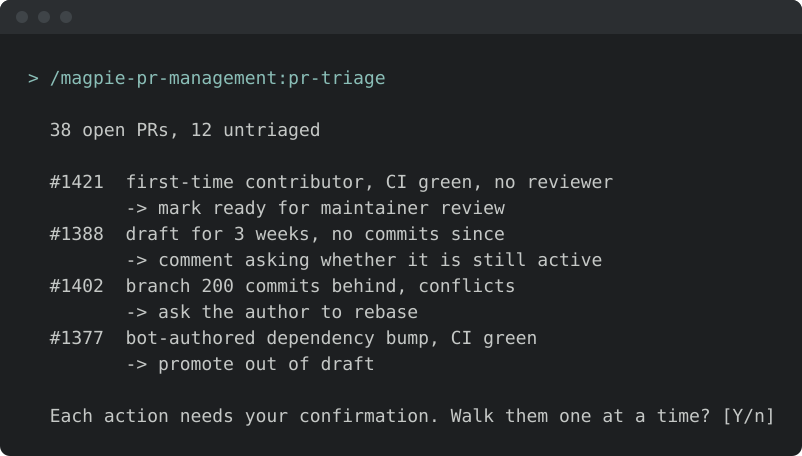
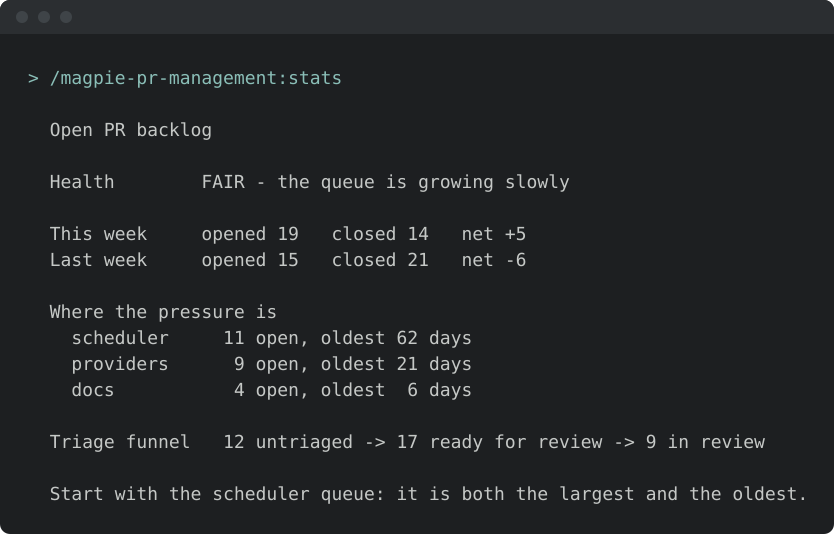

<!-- START doctoc generated TOC please keep comment here to allow auto update -->
<!-- DON'T EDIT THIS SECTION, INSTEAD RE-RUN doctoc TO UPDATE -->
**Table of Contents**  *generated with [DocToc](https://github.com/thlorenz/doctoc)*

- [Install & first runs](#install--first-runs)
  - [Before the first run](#before-the-first-run)
  - [Works well with](#works-well-with)
  - [Try these first](#try-these-first)

<!-- END doctoc generated TOC please keep comment here to allow auto update -->

<!-- SPDX-License-Identifier: Apache-2.0
     https://www.apache.org/licenses/LICENSE-2.0 -->

# Install & first runs

New to this family? Read the [one-minute welcome guide](../../plugins/magpie-setup/skills/setup/setup_preflight/guides/pr-management.md).

Install just this family — one plugin, 9 skills. Maintainer-facing PR-queue management.

Once you have [added the marketplace](../setup/marketplace-install.md):

```text
/plugin install magpie-pr-management@apache-magpie
```

New to Magpie? The [quick start](../quick-start.md) walks the whole path in
one place — install, the first `/magpie-setup:setup` run, and a recording of it
happening — plus the other agents and the secure-isolation setup to run next.

## Before the first run

<!-- BEGIN generated: skill-config (tools/dev/check-skill-config.py --fix) -->


*Illustrative — the real run derives more and asks better. What is true is
the shape: it runs itself, it writes only your personal layer, and it
stages nothing.*

Every skill here resolves project-specific values from the adopter's
[`<project-config>/`](../../plugins/magpie-setup/templates/) directory — which is
your personal layer first — `.apache-magpie-local/` (gitignored) in a
project that adopted Magpie, `<git-common-dir>/apache-magpie/` in one
that did not — then `.apache-magpie-overrides/` (committed, the project's).

**For yourself:** `/magpie-setup:setup config` scaffolds and fills these locally
(`/magpie-setup config` on a [pinned-snapshot install](../setup/marketplace.md#skill-names-differ-by-install-method)).
Nothing is staged, nothing is committed, and it works on a repository that
has never adopted Magpie.

**For the project:** [`/magpie-setup:setup adopt`](../setup/team-adoption.md)
commits them for every contributor, either scaffolded directly or promoted
from what you configured locally.

**Required.** Without these a skill would act on a guess, so it stops and
says which file is missing.

| File | What it carries | Read by |
|---|---|---|
| [`mentoring-config.md`](../../plugins/magpie-setup/templates/mentoring-config.md) | Tone knobs and hand-off protocol for the thread-level mentoring skill. | `thread-mentor` |
| [`pr-management-code-review-criteria.md`](../../plugins/magpie-setup/templates/pr-management-code-review-criteria.md) | List of project's review-criteria source files (repo-wide AGENTS.md, code-review docs, per-area AGENTS.md), security-model calibration doc, backport-branch pattern, section-anchor URLs. | `code-review`, `stack-review` |
| [`pr-management-config.md`](../../plugins/magpie-setup/templates/pr-management-config.md) | Committers team handle, area-label prefix, project-specific labels (`ready for maintainer review`, etc.), grace windows. | `merge-candidates`, `pr-stale-sweep`, `pr-triage`, `stats` |
| [`pr-management-quick-merge-config.md`](../../plugins/magpie-setup/templates/pr-management-quick-merge-config.md) | Thresholds, path globs, and the merge-command template for the express lane. | `merge-candidates` |
| [`pr-management-triage-comment-templates.md`](../../plugins/magpie-setup/templates/pr-management-triage-comment-templates.md) | Comment-body URLs (PR quality criteria, two-stage triage rationale), AI-attribution footer wording, project display name. | `pr-triage` |
| [`project.md`](../../plugins/magpie-setup/templates/project.md) | Project manifest. Identity, repositories, mailing lists, tools enabled, CVE tooling, GitHub project-board + issue-template field declarations. The single file every skill reads to resolve project-scoped references. | `code-review`, `merge-candidates`, `pr-stale-sweep`, `pr-triage`, `pre-first-pr-check`, `reviewer-routing`, `stack-review`, `thread-mentor` |
| [`reviewer-roster.md`](../../plugins/magpie-setup/templates/reviewer-roster.md) | Who reviews what. | `reviewer-routing` |

**Optional.** Each has a documented fallback; absent, the skill still runs.

| File | What it carries | Read by |
|---|---|---|
| [`pr-management-triage-ci-check-map.md`](../../plugins/magpie-setup/templates/pr-management-triage-ci-check-map.md) | CI-check name pattern → category name + doc-URL mapping for the violations comment. | `pr-triage` |
| [`privacy-llm.md`](../../plugins/magpie-setup/templates/privacy-llm.md) | Which model tier may see which class of content, for projects routing foundation-private information away from third-party models. | `pr-triage`, `reviewer-routing` |
| [`release-trains.md`](../../plugins/magpie-setup/templates/release-trains.md) | Active release branches, release-manager attribution per cut, rotation rosters, security-team roster. | `reviewer-routing` |
| [`stale-sweep-config.md`](../../plugins/magpie-setup/templates/stale-sweep-config.md) | Grace windows and exemption labels for stale sweeps. Absent, the framework defaults apply. | `pr-stale-sweep` |

<!-- END generated: skill-config -->

<!-- BEGIN generated: companion-skills (tools/dev/check-companion-skills.py --fix) -->

## Works well with

Third-party packages, none of them required: this family works with none of
them installed, and Magpie neither bundles nor depends on any. They are named
because they are what a maintainer goes looking for next, and because the
answer differs by agent.

**[Code Review](https://github.com/anthropics/claude-plugins-official/tree/main/plugins/code-review)** — Anthropic

Automated pull-request review through several specialised agents, scored by confidence.

*With this family:* pr-management-code-review walks a maintainer through reviewing one PR at a time and drafts the review they post. This is the other half — a broad automated pass whose findings that review can weigh.

Available on **Claude Code** only.

**[roborev](https://roborev.io)** — Kenn Software (community, MIT)

A local CLI and daemon that reviews every commit in the background with the coding agent you already use, and feeds the findings back for a fix-and-re-review loop before you push.

*With this family:* pr-management-code-review reviews other people's PRs; roborev reviews your own branch before it becomes one, so the PRs you open arrive with the mechanical findings already fixed.

Available on **Claude Code**, **OpenAI Codex CLI**, **VS Code / GitHub Copilot**, **Google Antigravity**, **Cursor**.

On Claude Code under Magpie's secure agent setup, roborev cannot read ~/.roborev/ and fails on every call; Step B of setup-isolated-setup-install wires the exclusion and the prompt that keep it safe outside the sandbox, and Step B.2 optionally lets its post-commit hook review the agent's own commits. Without Homebrew, see https://roborev.io/docs/installation/ for the other installers.

Install commands per agent are in
[**Companion skill packages**](../setup/companion-skills.md).

<!-- END generated: companion-skills -->

## Try these first

*Illustrative shapes, not real transcripts — your output will differ. Nothing
below sends, merges, or posts anything without you confirming it.*

**Review a PR in depth.**

```text
> review PR #5193

  PR #5193  'Add retry to the S3 client'  +212 -18, 6 files
  2 blocking:   retry loop swallows KeyboardInterrupt (client.py:88)
                no test for the exhausted-retries path
  3 non-blocking nits. Review comment drafted, not posted.
```

**Triage the whole queue.**

```text
/magpie-pr-management:pr-triage
```



**See where the queue is stuck.**

```text
/magpie-pr-management:stats
```


