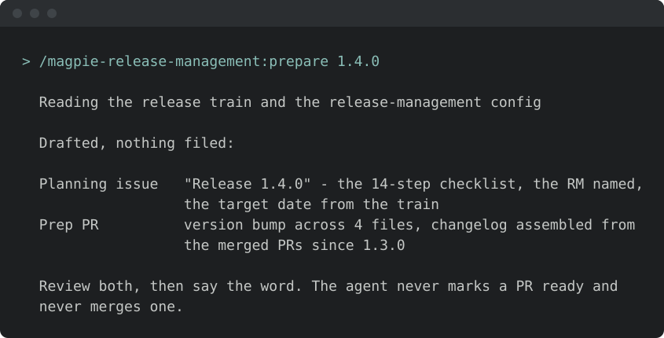
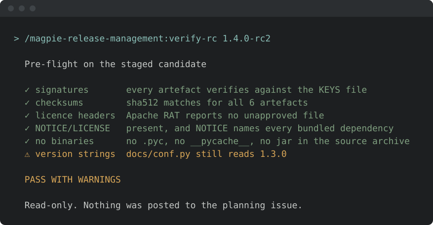
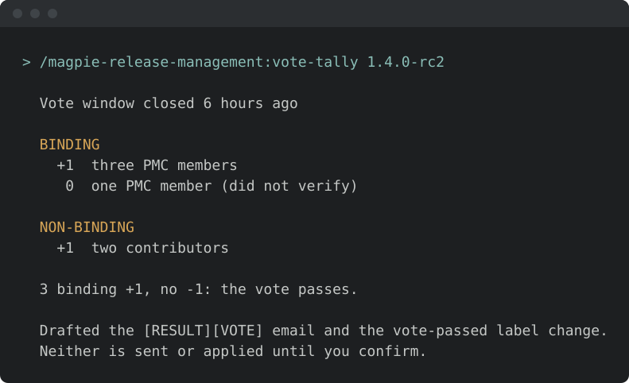

<!-- START doctoc generated TOC please keep comment here to allow auto update -->
<!-- DON'T EDIT THIS SECTION, INSTEAD RE-RUN doctoc TO UPDATE -->
**Table of Contents**  *generated with [DocToc](https://github.com/thlorenz/doctoc)*

- [Install & first runs](#install--first-runs)
  - [Before the first run](#before-the-first-run)
  - [Try these first](#try-these-first)

<!-- END doctoc generated TOC please keep comment here to allow auto update -->

<!-- SPDX-License-Identifier: Apache-2.0
     https://www.apache.org/licenses/LICENSE-2.0 -->

# Install & first runs

Install just this family — one plugin, 10 skills. The 14-step ASF release lifecycle. The agent never holds your signing key.

Once you have [added the marketplace](../setup/marketplace-install.md):

```text
/plugin install magpie-release-management@apache-magpie
```

New to Magpie? The [quick start](../quick-start.md) walks the whole path in
one place — install, the first `/magpie-setup:setup` run, and a recording of it
happening — plus the other agents and the secure-isolation setup to run next.

The first release-management skill you run opens with a one-minute
[welcome guide](../../plugins/magpie-setup/skills/setup/setup_preflight/guides/release-management.md):
the typical flow, what needs configuring, what to ask it, and how to make it yours.
Dismiss it, or hide it for good, from its last line;
*"show the release-management welcome again"* or `/magpie-setup:welcome-guide release-management` brings it back.

## Before the first run

<!-- BEGIN generated: skill-config (tools/dev/check-skill-config.py --fix) -->


*Illustrative — the real run derives more and asks better. What is true is
the shape: it runs itself, it writes only your personal layer, and it
stages nothing.*

Every skill here resolves project-specific values from the adopter's
[`<project-config>/`](../../plugins/magpie-setup/templates/) directory — which is
your personal layer first — `.apache-magpie-local/` (gitignored) in a
project that adopted Magpie, `<git-common-dir>/apache-magpie/` in one
that did not — then `.apache-magpie-overrides/` (committed, the project's).

**For yourself:** `/magpie-setup:setup config` scaffolds and fills these locally
(`/magpie-setup config` on a [pinned-snapshot install](../setup/marketplace.md#skill-names-differ-by-install-method)).
Nothing is staged, nothing is committed, and it works on a repository that
has never adopted Magpie.

**For the project:** [`/magpie-setup:setup adopt`](../setup/team-adoption.md)
commits them for every contributor, either scaffolded directly or promoted
from what you configured locally.

**Required.** Without these a skill would act on a guess, so it stops and
says which file is missing.

| File | What it carries | Read by |
|---|---|---|
| [`pmc-roster.md`](../../plugins/magpie-setup/templates/pmc-roster.md) | Who is binding. Read wherever a vote is counted or a PMC-only action is gated. | `promote`, `vote-tally` |
| [`release-build.md`](../../plugins/magpie-setup/templates/release-build.md) | How this project builds and signs artefacts: reproducible source-archive recipe (`git archive` + `.gitattributes`), build command, the project's optional convenience artefacts (each with its own build, staging, reproducibility mode, vote scope and publish channel), artefact names, checksum algorithm, optional reproducibility checks. | `rc-cut`, `verify-rc` |
| [`release-management-config.md`](../../plugins/magpie-setup/templates/release-management-config.md) | Vote window and pass rule, distribution backend and paths, announce/vote list addresses, retention rule. | `announce-draft`, `archive-sweep`, `audit-report`, `keys-sync`, `prepare`, `promote`, `rc-cut`, `verify-rc`, `vote-draft`, `vote-tally` |
| [`release-trains.md`](../../plugins/magpie-setup/templates/release-trains.md) | Active release branches, release-manager attribution per cut, rotation rosters, security-team roster. | `archive-sweep`, `prepare` |

**Optional.** Each has a documented fallback; absent, the skill still runs.

| File | What it carries | Read by |
|---|---|---|
| [`canned-responses.md`](../../plugins/magpie-setup/templates/canned-responses.md) | Reusable reporter-facing reply templates. | `announce-draft`, `vote-draft` |
| [`project.md`](../../plugins/magpie-setup/templates/project.md) | Project manifest. Identity, repositories, mailing lists, tools enabled, CVE tooling, GitHub project-board + issue-template field declarations. The single file every skill reads to resolve project-scoped references. | `audit-report` |

<!-- END generated: skill-config -->

## Try these first

*Illustrative shapes, not real transcripts — your output will differ. Nothing
below sends, merges, or posts anything without you confirming it.*

**Open the release plan.**

```text
/magpie-release-management:prepare
```



**Check an RC before you vote.**

```text
/magpie-release-management:verify-rc
```



**Tally the vote thread.**

```text
/magpie-release-management:vote-tally
```


