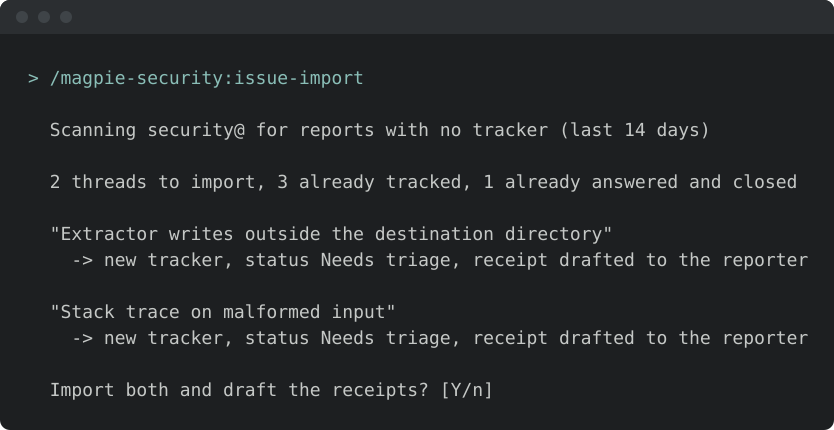
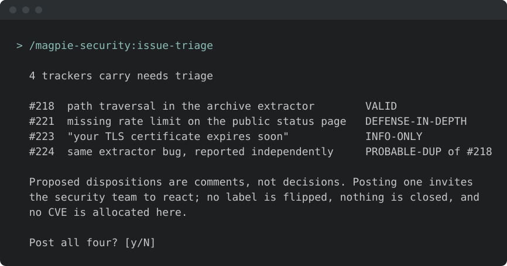
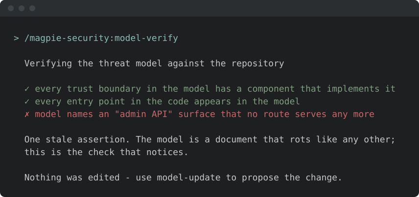

<!-- START doctoc generated TOC please keep comment here to allow auto update -->
<!-- DON'T EDIT THIS SECTION, INSTEAD RE-RUN doctoc TO UPDATE -->
**Table of Contents**  *generated with [DocToc](https://github.com/thlorenz/doctoc)*

- [Install & first runs](#install--first-runs)
  - [Before the first run](#before-the-first-run)
  - [Works well with](#works-well-with)
  - [Try these first](#try-these-first)

<!-- END doctoc generated TOC please keep comment here to allow auto update -->

<!-- SPDX-License-Identifier: Apache-2.0
     https://www.apache.org/licenses/LICENSE-2.0 -->

# Install & first runs

Install just this family — one plugin, 16 skills. The security-report lifecycle, from intake through CVE publication.

Once you have [added the marketplace](../setup/marketplace-install.md):

```text
/plugin install magpie-security@apache-magpie
/plugin install magpie-security-tools@apache-magpie   # the framework tools the skills run
```

New to Magpie? The [quick start](../quick-start.md) walks the whole path in
one place — install, the first `/magpie-setup:setup` run, and a recording of it
happening — plus the other agents and the secure-isolation setup to run next.

The first security skill you run opens with a one-minute
[welcome guide](../../plugins/magpie-setup/skills/setup/setup_preflight/guides/security.md):
the typical flow, configuring Magpie, what to ask it, and how to make it yours.
Dismiss it, or hide it for good, from its last line;
*"show the security welcome again"* or `/magpie-setup:welcome-guide security` brings it back.

## Before the first run

<!-- BEGIN generated: skill-config (tools/dev/check-skill-config.py --fix) -->


*Illustrative — the real run derives more and asks better. What is true is
the shape: it runs itself, it writes only your personal layer, and it
stages nothing.*

Every skill here resolves project-specific values from the adopter's
[`<project-config>/`](../../plugins/magpie-setup/templates/) directory — which is
your personal layer first — `.apache-magpie-local/` (gitignored) in a
project that adopted Magpie, `<git-common-dir>/apache-magpie/` in one
that did not — then `.apache-magpie-overrides/` (committed, the project's).

**For yourself:** `/magpie-setup:setup config` scaffolds and fills these locally
(`/magpie-setup config` on a [pinned-snapshot install](../setup/marketplace.md#skill-names-differ-by-install-method)).
Nothing is staged, nothing is committed, and it works on a repository that
has never adopted Magpie.

**For the project:** [`/magpie-setup:setup adopt`](../setup/team-adoption.md)
commits them for every contributor, either scaffolded directly or promoted
from what you configured locally.

**Required.** Without these a skill would act on a guess, so it stops and
says which file is missing.

| File | What it carries | Read by |
|---|---|---|
| [`canned-responses.md`](../../plugins/magpie-setup/templates/canned-responses.md) | Reusable reporter-facing reply templates. | `issue-invalidate`, `issue-triage` |
| [`fix-workflow.md`](../../plugins/magpie-setup/templates/fix-workflow.md) | Fork / clone / toolchain specifics, backport-label policy, commit-trailer wording, PR scrubbing, private-PR fallback. | `issue-fix` |
| [`milestones.md`](../../plugins/magpie-setup/templates/milestones.md) | Milestone naming conventions + create-and-assign recipe. | `issue-sync` |
| [`project.md`](../../plugins/magpie-setup/templates/project.md) | Project manifest. Identity, repositories, mailing lists, tools enabled, CVE tooling, GitHub project-board + issue-template field declarations. The single file every skill reads to resolve project-scoped references. | `cve-allocate`, `issue-deduplicate`, `issue-fix`, `issue-import`, `issue-import-from-md`, `issue-import-from-pr`, `issue-import-from-scan`, `issue-import-via-forwarder`, `issue-invalidate`, `issue-triage`, `model-verify`, `submit-to-oss-scan`, `tracker-stats-dashboard` |
| [`release-trains.md`](../../plugins/magpie-setup/templates/release-trains.md) | Active release branches, release-manager attribution per cut, rotation rosters, security-team roster. | `issue-triage` |
| [`scanner-products.md`](../../plugins/magpie-setup/templates/scanner-products.md) | Private scanner product names, and the finder-anonymisation rule applied before anything is quoted publicly. | `issue-sync` |
| [`scope-labels.md`](../../plugins/magpie-setup/templates/scope-labels.md) | Scope label → CVE product / `packageName` / collection-URL mapping. Exactly one scope label per tracker. | `issue-deduplicate`, `issue-import-from-md`, `issue-import-from-pr`, `issue-triage`, `tracker-stats-dashboard` |
| [`security-intake-config.md`](../../plugins/magpie-setup/templates/security-intake-config.md) | Capability-flag vocabulary for the intake path: how reports arrive, what counts as in scope, and what a receipt says. | `issue-import` |
| [`security-model.md`](../../plugins/magpie-setup/templates/security-model.md) | Authoritative URL for the project's Security Model + known-useful anchors + drafting rule. | `issue-triage`, `model-prepare`, `model-update`, `model-verify`, `submit-to-oss-scan` |
| [`security-tracker-stats.md`](../../plugins/magpie-setup/templates/security-tracker-stats.md) | Which tracker fields and windows the stats dashboard reads, and what it publishes. | `tracker-stats-dashboard` |
| [`title-normalization.md`](../../plugins/magpie-setup/templates/title-normalization.md) | Regex cascade the `security-cve-allocate` skill applies to tracker titles before pasting them into the CVE-tool allocation form. | `cve-allocate` |

**Optional.** Each has a documented fallback; absent, the skill still runs.

| File | What it carries | Read by |
|---|---|---|
| [`distributor-list.md`](../../plugins/magpie-setup/templates/distributor-list.md) | The embargo distributor list a pre-announcement goes to, and what it may contain. Absent, no pre-announcement is proposed. | `issue-sync` |
| [`naming-conventions.md`](../../plugins/magpie-setup/templates/naming-conventions.md) | Project-specific editorial rules. Keep only the ones that differ from the generic rules in `../../AGENTS.md`. | `issue-sync` |
| [`privacy-llm.md`](../../plugins/magpie-setup/templates/privacy-llm.md) | Which model tier may see which class of content, for projects routing foundation-private information away from third-party models. | `issue-import` |

<!-- END generated: skill-config -->

<!-- BEGIN generated: companion-skills (tools/dev/check-companion-skills.py --fix) -->

## Works well with

Third-party packages, none of them required: this family works with none of
them installed, and Magpie neither bundles nor depends on any. They are named
because they are what a maintainer goes looking for next, and because the
answer differs by agent.

**[Aikido Security](https://www.aikido.dev/)** — Aikido

SAST, secrets and infrastructure-as-code scanning surfaced in the session.

*With this family:* A second opinion from a conventional scanner, and a different class of finding — committed secrets — from the ones a code-reading scan surfaces.

Available on **Claude Code** only.

**[Claude Security](https://code.claude.com/docs/en/claude-security)** — Anthropic

A multi-agent vulnerability scan of your own repository, run inside the session; each finding carries a severity, a CWE category and reproduction steps, and the ones you pick become patch files you review before applying.

*With this family:* This family handles reports that arrive — intake, triage, CVE, advisory. Scanning finds the ones nobody reported. The two meet at security-issue-import-from-scan, which imports scanner output as trackers.

Available on **Claude Code** only.

Claude Code only: it drives subagents and a scan workflow that Agent Plugins 1.0 has no component for. Listed with its harness named rather than presented as the answer for everyone.

Install commands per agent are in
[**Companion skill packages**](../setup/companion-skills.md).

<!-- END generated: companion-skills -->

## Try these first

*Illustrative shapes, not real transcripts — your output will differ. Nothing
below sends, merges, or posts anything without you confirming it.*

**Pull new reports out of the mailbox.**

```text
/magpie-security:issue-import
```



**Triage what came in.**

```text
/magpie-security:issue-triage
```



**Check the security model still matches reality.**

```text
/magpie-security:model-verify
```


