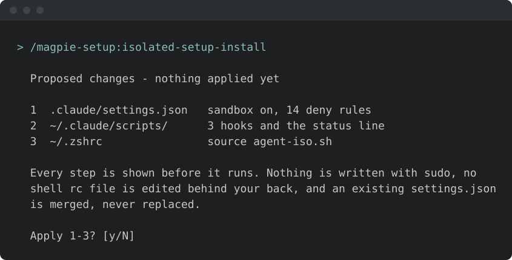
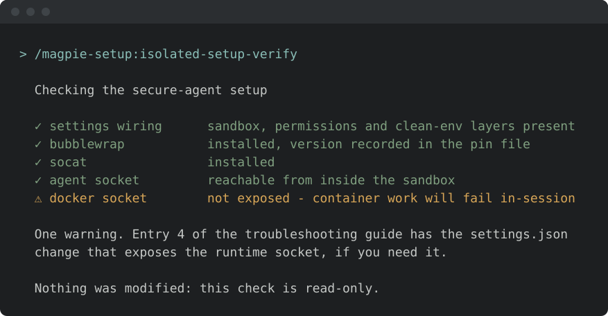
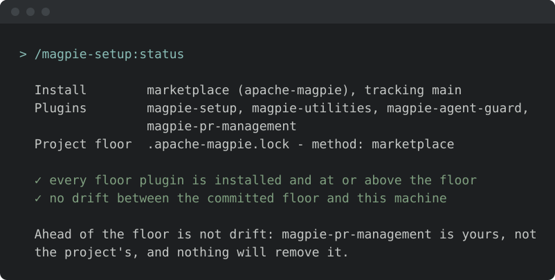

<!-- START doctoc generated TOC please keep comment here to allow auto update -->
<!-- DON'T EDIT THIS SECTION, INSTEAD RE-RUN doctoc TO UPDATE -->
**Table of Contents**  *generated with [DocToc](https://github.com/thlorenz/doctoc)*

- [Install & first runs](#install--first-runs)
  - [The first run](#the-first-run)
  - [Before the first run](#before-the-first-run)
  - [Try these first](#try-these-first)

<!-- END doctoc generated TOC please keep comment here to allow auto update -->

<!-- SPDX-License-Identifier: Apache-2.0
     https://www.apache.org/licenses/LICENSE-2.0 -->

# Install & first runs

Install just this family — one plugin, 12 skills. Sandbox, clean environment, and the framework's own install/upgrade.

Once you have [added the marketplace](../setup/marketplace-install.md):

```text
/plugin install magpie-setup@apache-magpie
```

New to Magpie? The [quick start](../quick-start.md) walks the whole path in
one place — install, the first `/magpie-setup:setup` run, and a recording of it
happening — plus the other agents and the secure-isolation setup to run next.

The `setup` skill (`/magpie-setup:setup`) opens with a one-minute
[welcome guide](../../plugins/magpie-setup/skills/setup/setup_preflight/guides/setup.md):
the typical flow, what needs configuring, what to ask it, and how to make it yours.
If no Magpie skill has run here before, the general Magpie welcome comes first and this one on the next `setup` run.
The other setup-family skills do not show it.
Dismiss it, or hide it for good, from its last line;
*"show the setup welcome again"* or `/magpie-setup:welcome-guide setup` brings it back.

## The first run

This family is what the other nine defer to. `/magpie-setup:setup` (`/magpie-setup`
on a [pinned-snapshot install](marketplace.md#skill-names-differ-by-install-method)) works out how
Magpie should be wired into the checkout in front of it, prints the plan, and
waits — the same run the quick start opens with:


Nothing is written before you approve it.

## Before the first run

<!-- BEGIN generated: skill-config (tools/dev/check-skill-config.py --fix) -->

**Nothing here has to be configured.** These skills read the file below
when it exists — yours in your personal layer or the project's in
`.apache-magpie-overrides/` — and fall back to a documented default when
it does not.

**Optional.** Each has a documented fallback; absent, the skill still runs.

| File | What it carries | Read by |
|---|---|---|
| [`magpie-setup.md`](../../plugins/magpie-setup/templates/magpie-setup.md) | Overrides for the setup family's own checks. Every key has a default. | `setup` |
| [`privacy-llm.md`](../../plugins/magpie-setup/templates/privacy-llm.md) | Which model tier may see which class of content, for projects routing foundation-private information away from third-party models. | `privacy-llm` |
| [`project.md`](../../plugins/magpie-setup/templates/project.md) | Project manifest. Identity, repositories, mailing lists, tools enabled, CVE tooling, GitHub project-board + issue-template field declarations. The single file every skill reads to resolve project-scoped references. | `isolated-setup-install`, `setup` |
| [`skill-sources.md`](../../plugins/magpie-setup/templates/skill-sources.md) | The install gate for pulling skills/families from trusted external repos. Lists the source ids this project trusts and commits each pin. `/magpie-setup:setup` fetches only what is listed here. Leave empty to run only in-tree framework skills. See [`docs/skill-sources/`](../skill-sources/README.md). | `setup` |

<!-- END generated: skill-config -->

## Try these first

*Illustrative shapes, not real transcripts — your output will differ. Nothing
below sends, merges, or posts anything without you confirming it.*

**Put the agent in its sandbox.**

```text
/magpie-setup:isolated-setup-install
```



**Check it landed.**

```text
/magpie-setup:isolated-setup-verify
```



**See what is wired up.**

```text
/magpie-setup:status
```


